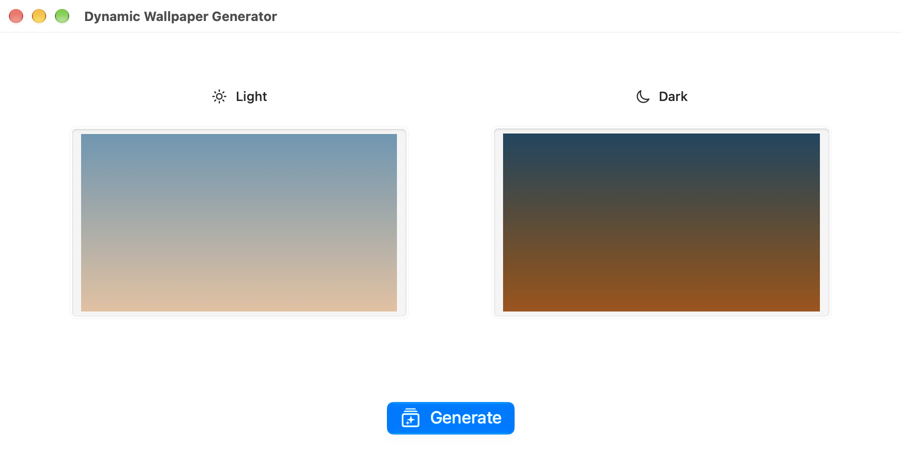

# DynamicWallpaperGenerator

Generates a wallpaper that can switch between light and dark modes like Apple’s built-in wallpapers.

The approach is based on https://remove.codes/01-dynamic-wallpaper.

