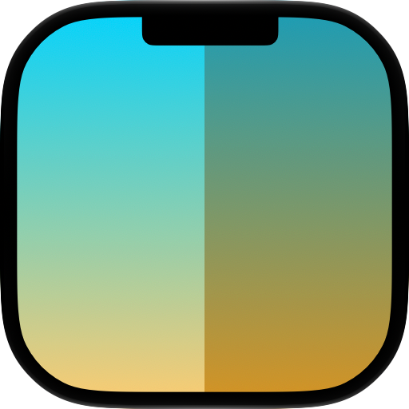

<picture>
  <source media="(prefers-color-scheme: dark)" srcset="readme-assets/icon-dark.png">
  <source media="(prefers-color-scheme: light)" srcset="readme-assets/icon-light.png">
  
</picture>

# DynamicWallpaperGenerator

Generates a wallpaper that can switch between light and dark modes like Apple’s built-in wallpapers.

The approach is based on https://remove.codes/01-dynamic-wallpaper.

<picture>
  <source media="(prefers-color-scheme: dark)" srcset="readme-assets/dynamic-wallpaper-generator-screenshot-dark.png">
  <source media="(prefers-color-scheme: light)" srcset="readme-assets/dynamic-wallpaper-generator-screenshot-light.png">
  
</picture>
